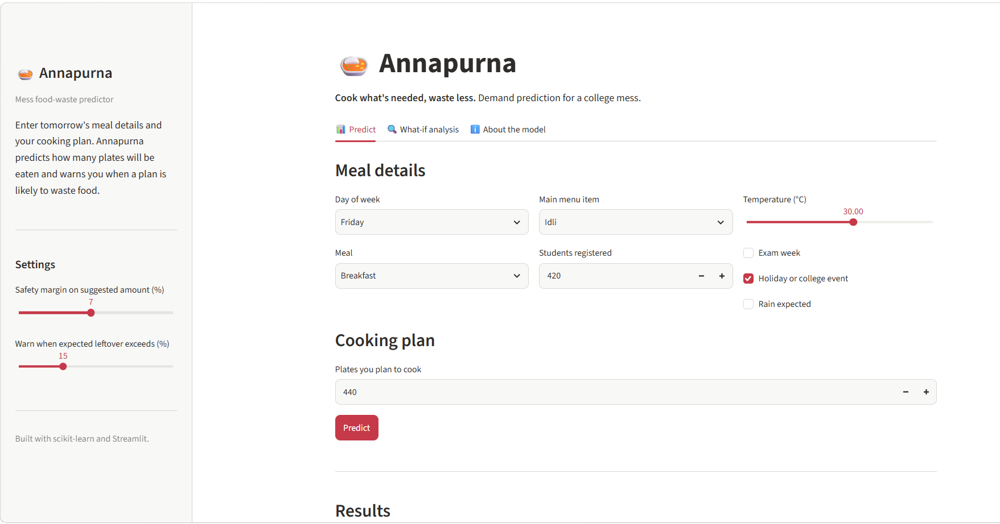

# 🍛 Annapurna – College Mess Food-Waste Predictor

Annapurna predicts how many plates a college mess will actually serve at a meal, and warns the kitchen when the planned quantity is likely to be wasted.

> **Data note:** The results below were produced on a **simulated dataset** (180 meal records, 60 days × 3 meals) that mimics a college mess register. Collecting real records from the college mess is in progress, and the `data_source` column marks which rows are real and which are simulated. Results should be re-checked once real data replaces the simulated rows.

## The problem

A mess cooks a fixed amount every day, but real demand changes with the day, the menu, exam weeks, events, rain and temperature. Cooking too much wastes food and money, and cooking too little leaves students hungry.

**Business problem → ML problem**

| Business question | ML task | Target |
|---|---|---|
| How many plates should we cook? | Regression | `plates_eaten` |
| Is today's cooking plan likely to waste a lot of food? | Binary classification | `high_waste` |
| What kinds of meals do we serve? | Clustering | none (unsupervised) |

## Dataset

| Column | Description |
|---|---|
| date, day_of_week, meal | When the meal happens (breakfast, lunch or dinner) |
| menu_main | Main dish |
| exam_week, holiday_or_event, rain | 0/1 flags |
| temperature_c | Temperature in °C |
| students_registered | Students registered for the meal |
| plates_cooked | Plates the kitchen cooked |
| plates_eaten | Plates actually eaten (**regression target**) |
| leftover_kg | Food left over |
| high_waste | 1 if leftover is in the top 30% (**classification target**) |
| data_source | `real` or `simulated` |

## Method (machine learning life cycle)

1. **Data preparation:** Filled 4 missing temperatures with the median. Dropped 4 rows missing the target `plates_eaten` (180 → 176 rows), because target values shouldn't be invented. IQR outlier check found one low `plates_eaten` value, which was inspected and kept because it was plausible.
2. **Scaling:** Min-max normalization and standardization were demonstrated. Standardization is used inside the classification pipeline.
3. **Splitting:** 70% train / 15% validation / 15% test (`random_state=42`). The test set was used once, at the end.
4. **Avoiding data leakage:**
   - The regression model uses only inputs known **before** the meal. `plates_cooked` and `leftover_kg` are excluded, because the model is meant to help decide how much to cook.
   - The classifier uses the planned quantity (`plates_cooked`) but never `leftover_kg`.

## Results

### Regression: predicting plates eaten (validation set)

| Model | MAE | MSE | R² |
|---|---|---|---|
| Simple linear (students registered only) | 16.04 | 379.19 | 0.434 |
| **Multiple linear (all 8 inputs)** | **11.55** | **176.60** | **0.737** |
| Polynomial (degree 2) | 11.78 | 182.47 | 0.728 |

**Final test-set score (Multiple Linear Regression, 27 rows):** MAE 7.18 plates, MSE 68.78, R² 0.767.

Multiple linear regression was chosen because it was simplest and at least as accurate as the polynomial model. The test set is small (27 rows), so the test score is encouraging but not precise.

### Classification: will this meal have high waste? (5-fold cross-validation)

| Model | Accuracy | Precision | Recall | F1 |
|---|---|---|---|---|
| Baseline (always "No") | 0.687 | 0.000 | 0.000 | 0.000 |
| Logistic Regression | 0.636 | 0.448 | 0.618 | 0.515 |
| KNN (k=5) | 0.630 | 0.360 | 0.200 | 0.248 |
| Naive Bayes | 0.545 | 0.365 | 0.582 | 0.442 |
| **SVM (RBF)** | 0.659 | 0.476 | 0.655 | **0.549** |

SVM gave the best recall and F1. Recall was the main metric because missing a high-waste meal costs more than a false alarm. Overall classification performance is **modest**: no model beat the baseline on accuracy, so the app also uses the regression model's expected leftover as its main warning rule.

A first attempt without the planned quantity scored below the baseline, so the question was reframed as "given today's cooking plan, will waste be high?"

### Clustering: meal patterns

K-Means (k=3) and hierarchical clustering (Ward linkage) grouped meals into:

1. **Busy and well-matched:** high attendance, low waste
2. **Over-cooked meals:** much more cooked than eaten, high waste
3. **Quiet meals, tight cooking:** lower attendance, low waste

Cluster structure is weak (silhouette ≈ 0.23), so the groups are descriptive and not sharply separated. `plates_eaten` and `leftover_kg` were used for clustering, so the clusters describe meals after the fact and do not predict anything.

## The app

A Streamlit app takes the day, meal, menu, weather, exam/event flags, registered students and the planned plates. It shows predicted plates eaten, a suggested amount to cook (with an adjustable safety margin), expected leftover and a waste warning.



## Run it yourself

```bash
git clone <your-repo-url>
cd annapurna-ml
python -m venv .venv
.venv\Scripts\activate        # Windows
pip install -r requirements.txt
streamlit run app/app.py
```

The trained models are expected at `models/annapurna_models.joblib`. To rebuild them, run the notebooks in order.

## Project structure

```
annapurna-ml/
├── app/app.py                      # Streamlit app
├── data/raw, data/processed        # datasets
├── models/annapurna_models.joblib  # trained models
├── notebooks/
│   ├── 01_dataset_exploration.ipynb   # libraries, features/labels, EDA
│   ├── 02_data_preprocessing.ipynb    # missing values, outliers, scaling, split
│   ├── 03_regression.ipynb            # simple, multiple, polynomial, cost function
│   ├── 04_classification.ipynb        # logistic, KNN, Naive Bayes, SVM
│   └── 05_clustering.ipynb            # K-Means, hierarchical
├── reports/figures/                # plots
└── requirements.txt
```

## Limitations and next steps

- Results are from **simulated data**. Real mess records need to be collected and the models retrained.
- The dataset is small (176 rows), so validation and test scores are noisy.
- The classifier is modest. More real data and better features (for example menu popularity) should help.
- The app only warns. It does not yet learn from new daily records.

## Tools

Python, pandas, NumPy, scikit-learn, Matplotlib, Seaborn, SciPy, Streamlit, Jupyter.

